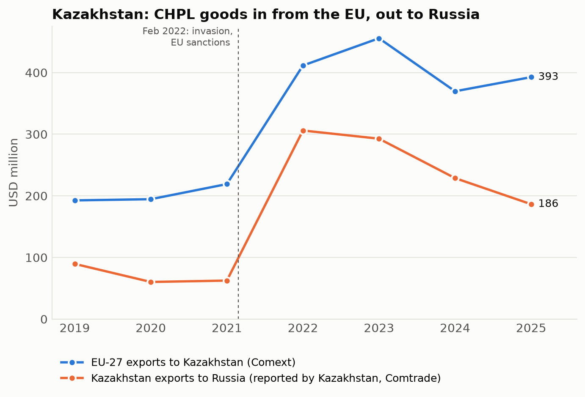
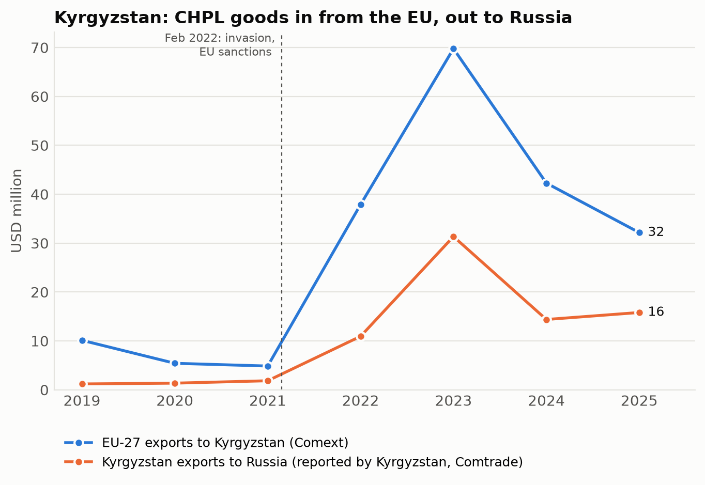
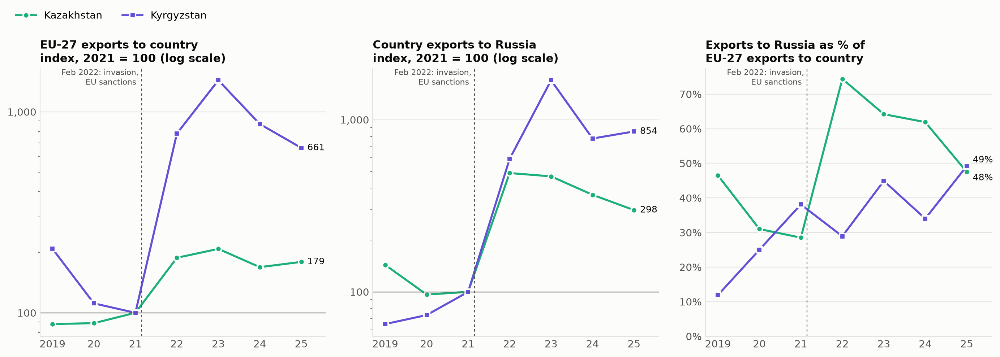

# Russia trade tracking

Tracking how sanctioned goods reach Russia through third countries. The first module covers
CHPL goods via Kazakhstan and Kyrgyzstan (EU → Central Asia → Russia).

## CHPL goods via Central Asia

This module looks at the **Common High Priority List (CHPL)** goods. These are 50 HS codes of
dual-use and advanced technology goods that the EU, US, UK and Japan found in Russian weapons in
Ukraine. Examples are integrated circuits, ball bearings and CNC machine tools.

The project compares two flows for 2019–2025:

1. **EU-27 exports** of CHPL goods to Kazakhstan and Kyrgyzstan (source: Eurostat Comext).
2. **Kazakhstan and Kyrgyzstan exports** of the same goods to Russia (source: UN Comtrade).
   Russia does not publish trade data after 2021, so we use the data that Kazakhstan and
   Kyrgyzstan report.

When both lines go up together after 2022, this can show re-export (circumvention) of
sanctioned goods. The data alone does not prove this.

## Results







CHPL basket (49 codes, see *Method*), USD million:

| Year | EU → KZ | KZ → RU | EU → KG | KG → RU |
|-----:|--------:|--------:|--------:|--------:|
| 2019 | 192.6 | 89.6 | 10.1 | 1.2 |
| 2020 | 194.5 | 60.2 | 5.4 | 1.4 |
| 2021 | 219.1 | 62.5 | 4.9 | 1.8 |
| 2022 | 411.5 | 306.0 | 37.9 | 10.9 |
| 2023 | 455.7 | 292.7 | 69.8 | 31.3 |
| 2024 | 369.6 | 228.7 | 42.3 | 14.4 |
| 2025 | 392.6 | 186.4 | 32.2 | 15.8 |

**Kazakhstan versus Kyrgyzstan**

- **Size.** Kazakhstan is much larger. In 2023, EU exports to Kazakhstan were about 6.5 times
  the EU exports to Kyrgyzstan. Kazakhstan exports to Russia were about 9 times the Kyrgyz exports.
- **Growth.** Kyrgyzstan grew much faster from a very small base. From 2021 to the 2023 peak,
  EU exports to Kyrgyzstan increased about 14 times and Kyrgyz exports to Russia about 17 times.
  For Kazakhstan, EU exports increased about 2 times (peak in 2023) and exports to Russia about
  5 times (peak in 2022).
- **Ratio.** Kazakhstan exports to Russia were 28% of EU exports to Kazakhstan in 2021. The ratio
  went to 74% in 2022. Then it went down to 48% in 2025. The Kyrgyz ratio was between 29% and 49%
  after 2021, with no clear direction.
- **After the peak.** Both flows went down after 2023, but they stay far above the 2021 level.
  In 2025, Kazakhstan exports to Russia are 3 times the 2021 level, and Kyrgyz exports are 8.5 times.

The comparison table for all years is in
[`data/processed/comparison.csv`](data/processed/comparison.csv).

## Method

- **CHPL list.** Version of February 2024 (50 HS codes in Tiers 1–4). Source: European Commission,
  [List of Common High Priority Items](https://finance.ec.europa.eu/document/download/5a2494db-d874-4e2b-bf2a-ec5a191d2dc0_en).
  The codes are in [`data/chpl_hs_codes.csv`](data/chpl_hs_codes.csv).
- **EU exports.** Eurostat Comext, dataset `DS-045409`, reporter `EU27_2020`, flow = export,
  HS6 level. Values are in EUR. We convert them to USD with the ECB annual average rate.
- **Exports to Russia.** UN Comtrade public API, reporter = Kazakhstan (398) or Kyrgyzstan (417),
  partner = Russia (643), flow = export, HS6 level, USD.
- **HS versions.** The CHPL uses HS 2022 codes. Data for 2019–2021 uses HS 2017. For three codes we
  use the HS 2017 code for those years:
  - `880730` ← `880330` (aircraft parts; same scope, UAVs added in HS 2022)
  - `852589` ← `852580` (cameras; HS 2022 split this code)
  - `854149` ← `854140` (photosensitive devices)
- **Basket of 49 codes.** The HS 2017 code `854140` also includes solar cells and LEDs. This makes
  2019–2021 values much too high. So the totals and charts do not include `854149`. The data for
  this code stays in `data/processed/trade_by_code.csv` (`in_basket = False`).

### Limits

- Exporter data and importer data are not the same. Kazakhstan and Kyrgyzstan export data for
  Russia can be lower than the true value, because both countries are in the Eurasian Economic
  Union and there are no customs checks on the border.
- The EU reports exports by the country of final destination that is known at export. Goods can
  go to a third country first.
- An HS6 code is wider than the controlled goods. Not all goods under a CHPL code are sanctioned.
- 2025 data can change when the agencies revise it.

## Website

The interactive site is in [`docs/`](docs/). It has hover tooltips, a country switch, a
"which goods" chart for each year, data tables, and light and dark mode. It uses no libraries and
no build step. The pipeline writes the data to `docs/data.js`.

- **Local:** open `docs/index.html` in a browser, or run `make serve` and go to
  <http://localhost:8770>.
- **GitHub Pages:** push the repository to GitHub. Then go to *Settings → Pages* and set
  *Source* to *Deploy from a branch*, branch `main`, folder `/docs`. The site goes to
  `https://<user>.github.io/russia-trade-tracking/`.

## Use

```bash
make setup   # create .venv and install packages
make run     # download (only once), build tables, make charts and site data
make refresh # download all data again
make serve   # show the site at http://localhost:8770
```

The first run saves the API responses in `data/raw/` (not in git). Later runs use these files.

## Project structure

```
data/
  chpl_hs_codes.csv        CHPL HS codes and tiers
  processed/               tidy tables made by the pipeline
  raw/                     API responses (not in git)
docs/                      website (GitHub Pages)
figures/                   charts
src/chpl_trade/
  config.py                years, countries, HS code mapping
  fetch.py                 download from Comext, Comtrade, ECB
  build.py                 make tidy tables
  plot.py                  make charts and comparison table
  site.py                  write docs/data.js for the website
```

## Ideas for later

- Add more countries: Armenia, Georgia, Uzbekistan, Türkiye, UAE.
- Add mirror data: Kazakhstan and Kyrgyzstan imports from the EU, compared with EU exports.
- Show each CHPL tier on its own.
- Use monthly data to see the exact time of changes.
- Add exports to Russia from China and other sources of CHPL goods.
